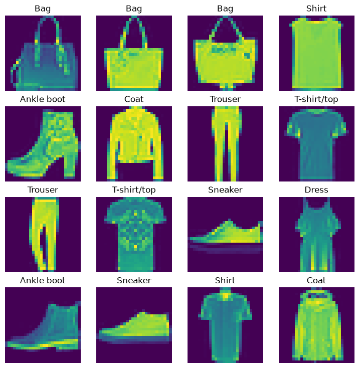
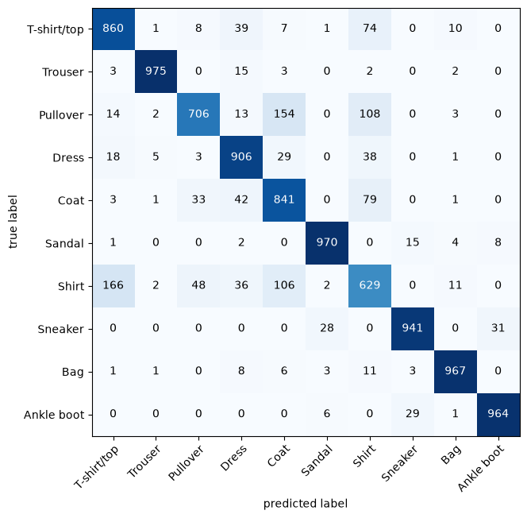

# Machine Learning & Deep Learning with PyTorch

My hands-on notebooks from learning deep learning with **PyTorch**, alongside my
M.Eng. in *Artificial Intelligence for Smart Sensors and Actuators* (Deggendorf
Institute of Technology). The focus is on computer vision first, then the
mechanics of large language models.


---

## Highlights

### FashionMNIST: linear baseline vs CNN

| Model | Architecture | Test accuracy |
|---|---|---|
| Linear baseline | Flatten → Linear → Linear | 84.0 % |
| **CNN** | 2 × (Conv-ReLU-Conv-ReLU-MaxPool) → Linear | **87.6 %** (3 epochs, 58 s on GPU) |

<p align="center">
  
  &nbsp;
  
</p>

The confusion matrix shows where the CNN struggles: **Shirt** is the hardest
class (63 % correct), mostly confused with T-shirt/top, Coat and Pullover.
Trousers, bags, sandals and ankle boots are above 96 %.

→ [`pytorch-course/03_computer_vision_fashionmnist.ipynb`](pytorch-course/03_computer_vision_fashionmnist.ipynb)

---

## Contents

### `pytorch-course/`: Zero to Mastery, *Learn PyTorch for Deep Learning*

| Notebook | Topics |
|---|---|
| [00_pytorch_basics](pytorch-course/00_pytorch_basics.ipynb) | Environment check, CUDA, first tensors |
| [03_computer_vision_fashionmnist](pytorch-course/03_computer_vision_fashionmnist.ipynb) | `torchvision` datasets, `DataLoader`, linear model vs CNN, device-agnostic train/test functions, confusion matrix |
| [04_custom_datasets](pytorch-course/04_custom_datasets.ipynb) | Downloading and exploring an image-folder dataset (pizza / steak / sushi), transforms and data augmentation *(in progress)* |

`helper_functions.py` comes from the course repository.

### `llm-course/`: *A deep understanding of AI large language model mechanisms*

Course code by Mike X Cohen that I'm working through: tokenization and
embeddings, building a GPT-style transformer from scratch, pretraining and
fine-tuning, evaluation, and mechanistic interpretability (hooks, attention
heads, activation patching). See [`llm-course/README.md`](llm-course/README.md).

---

## Running the notebooks

```bash
git clone https://github.com/muemara1/ML.git
cd ML
python -m venv .venv-gpu
# Windows: .venv-gpu\Scripts\activate    Linux/macOS: source .venv-gpu/bin/activate

# For an NVIDIA GPU, install the CUDA build of torch first (see pytorch.org)
pip install -r requirements.txt
jupyter notebook
```

Datasets are not stored in the repo. Each notebook downloads its data into a
local `data/` folder on first run.

---

## Credits

- **PyTorch course:** Daniel Bourke, [Zero to Mastery: Learn PyTorch for Deep Learning](https://www.learnpytorch.io/)
  ([code](https://github.com/mrdbourke/pytorch-deep-learning), MIT License).
- **LLM course:** This software includes code developed by Mike X Cohen for the
  Udemy course "A deep understanding of AI large language model mechanisms"
  ([udemy.com/course/dulm_x](https://www.udemy.com/course/dulm_x/)), used under
  the MIT License (Attribution Required). See [`llm-course/LICENSE`](llm-course/LICENSE).
