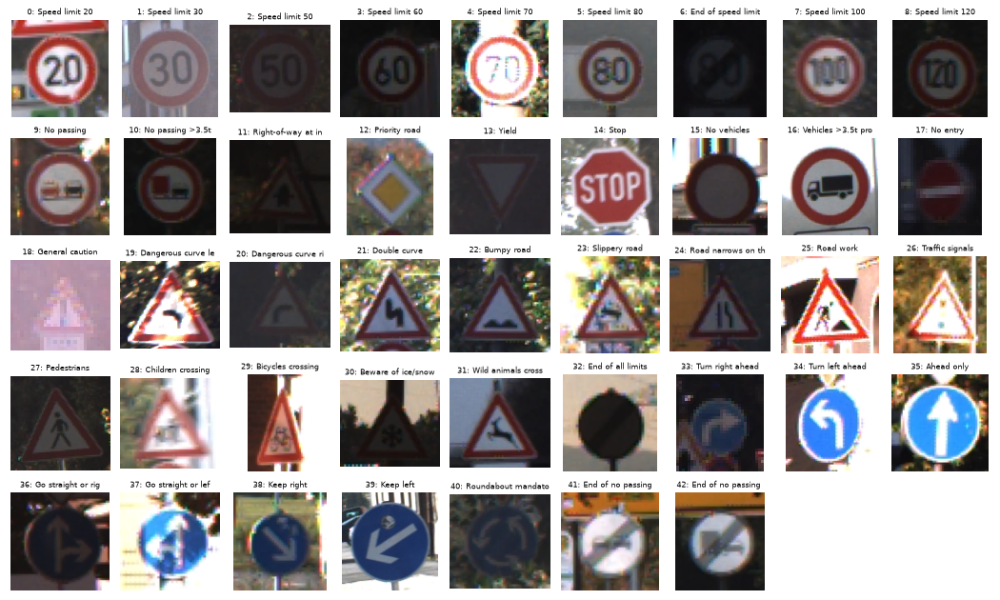
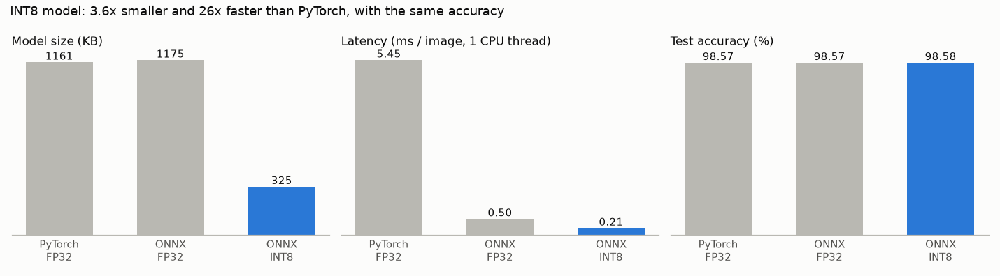
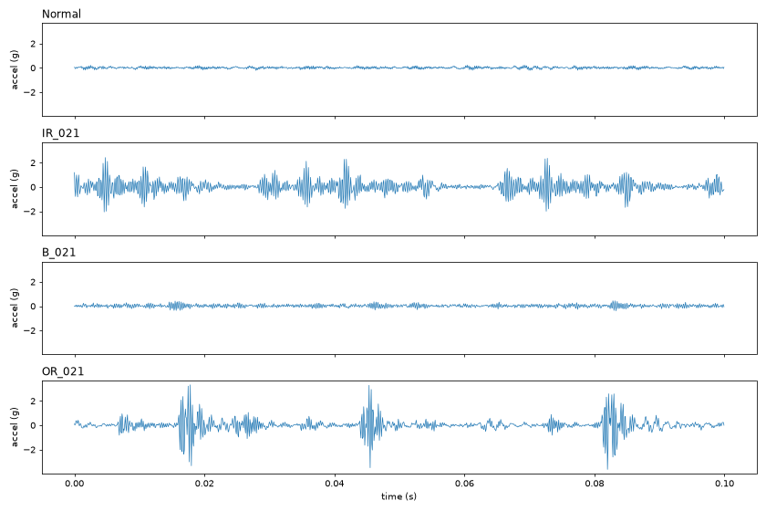
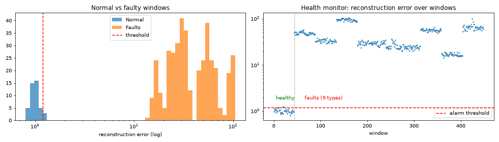
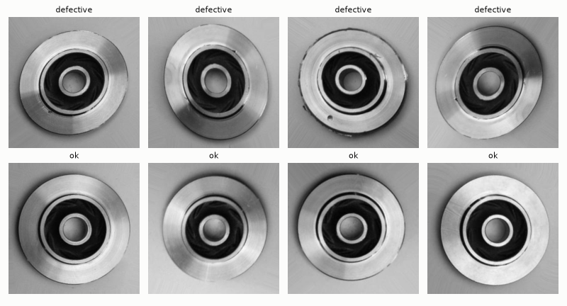

# Machine Learning & Computer Vision Projects

I come from industrial machine maintenance: I used to fix machines **after** they broke.
Now I build models that see defects, predict failures **before** they happen, and run on small hardware.

All projects use **Python, PyTorch and scikit-learn**, and each one is a single notebook you can run from top to bottom.

| Project | Data | Key result |
|---|---|---|
| [🚦 Traffic sign recognition → deployment](#-traffic-sign-recognition-from-training-to-deployment) | GTSRB, 43 classes, 39k images | **98.6%** test accuracy, INT8 model **3.6× smaller**, **0.21 ms** per image on 1 CPU thread |
| [🔧 Bearing fault detection (predictive maintenance)](#-bearing-fault-detection-from-vibration-predictive-maintenance) | CWRU vibration signals | Autoencoder trained on **healthy data only**: detects **100%** of faults with **0.9%** false alarms |
| [🏭 Casting defect detection](#-casting-defect-detection) | 7.3k images of metal castings | **97%** test accuracy with a small CNN |

---

## 🚦 Traffic sign recognition: from training to deployment
📓 [`traffic_signs.ipynb`](traffic_signs.ipynb) · 📦 [`deploy/`](deploy/)

Training a good classifier is the easy part. Car makers care about **size, speed and running without a big framework**. This project goes all the way from data to a standalone app.



**What I did**
- **Leak-free validation split by track.** GTSRB films every real sign 30 times from a moving car. A random split puts almost identical photos in both train and validation, so I split by *physical sign* instead.
- **Augmentation that keeps the meaning:** small rotations, shifts and light changes, but **no horizontal flips**, because a flipped "Keep right" *is* "Keep left".
- **A small CNN** (293k parameters, 3 conv blocks + global average pooling) with label smoothing and a cosine learning-rate schedule.
- **Deployment pipeline:** PyTorch → **ONNX** → **INT8 static quantization** (calibrated on training images), measured like an embedded device: 1 CPU thread, batch size 1, with warm-up.
- **A standalone predictor** ([`deploy/predict_sign.py`](deploy/predict_sign.py)) that needs only `onnxruntime`, `numpy` and `Pillow`. The preprocessing settings are saved in `labels.json`, so the device does exactly the same steps as training.



| Version | Size | Latency (1 thread) | Test accuracy |
|---|---|---|---|
| PyTorch FP32 | 1161 KB | 5.45 ms | 98.57% |
| ONNX FP32 | 1175 KB | 0.50 ms | 98.57% |
| **ONNX INT8** | **325 KB** | **0.21 ms** | **98.58%** |

**Limits & next steps:** GTSRB images are already cropped around the sign. A real car first needs a **detector** (e.g. YOLO) to find signs in the full camera frame. Latency was measured on a laptop CPU; the next step is measuring on a Raspberry Pi.

---

## 🔧 Bearing fault detection from vibration (predictive maintenance)
📓 [`bearing_faults_full.ipynb`](bearing_faults_full.ipynb)

An accelerometer on a motor bearing records vibration 12,000 times per second. A crack makes a small "hit" every time a ball rolls over it. The goal is to recognize these patterns **before** the bearing fails.
10 classes: healthy + 3 fault locations (inner race, ball, outer race) × 3 fault sizes.



**What I did**
- **Leak-free split by time:** each recording is split 60/20/20 **before** cutting it into windows, so overlapping windows never appear in both train and test.
- **Classic ML baseline:** 26 physics-inspired features (RMS, kurtosis, crest factor, FFT band energies) + Random Forest.
- **1D CNN** on raw signal windows, with a wide first kernel.
- **Autoencoder for anomaly detection**, trained on **healthy data only**, which is the realistic case in a factory, where fault examples are rare. A high reconstruction error raises an alarm.
- **Robustness test** on new recordings at a different motor load (1 HP).



| Model | Same load (0 HP) | New load (1 HP) | New load, fault *location* only |
|---|---|---|---|
| Random Forest + features | 100% | 86.6% | **99.4%** |
| 1D CNN | 96.3% | 74.9% | 84.2% |

**Autoencoder at the new load:** detects **100%** of faults with **0.9%** false alarms, after calibrating the alarm threshold on a short healthy baseline (no fault data used).

**Problems I found and fixed**
- 🐛 **A hidden data bug:** the healthy recordings are sampled at **48 kHz**, the fault recordings at **12 kHz**. I found it with physics: the shaft frequency (1796 RPM / 60 ≈ 30 Hz) only appears in the right place at 48 kHz. Without resampling, models learn a shortcut ("slow-looking signal = healthy").
- 🎚️ **Alarm threshold:** trained at one load, the autoencoder flagged *every* healthy window at a new load, but healthy (error ≈ 5) and faulty (error ≥ 22) were still clearly separated. The fix is to calibrate the threshold per operating condition, like commissioning a real monitoring system.
- 📉 **Simple beats deep here:** with ~10 s of data per class, physics-based features + Random Forest generalize better to a new load than the CNN.

**Limits:** CWRU faults are artificially made on a lab test rig, and the data shows *fault vs. no fault*, not *time until failure*. The next step is a run-to-failure dataset (IMS, PRONOSTIA) for Remaining Useful Life prediction.

---

## 🏭 Casting defect detection
📓 [`casting_data_full.ipynb`](casting_data_full.ipynb)

Visual quality inspection of metal casting parts (submersible pump impellers): **defective** or **ok**.



**What I did**
- Loaded the images with `ImageFolder` (grayscale, 64×64) and built a small CNN (2 conv blocks + classifier) in PyTorch.
- Trained it with the standard training loop, tracked loss/accuracy curves, and saved and reloaded the model (`state_dict`).
- Evaluated with a **confusion matrix**, not only accuracy: in a factory, the costly mistake is shipping a **defective** part as "ok".

**Result:** **97.0%** test accuracy; 97.6% of defective parts caught (recall).

---

## ⚙️ How to run

```bash
python -m venv .venv
.venv\Scripts\activate          # Windows  (Linux/macOS: source .venv/bin/activate)
pip install torch torchvision scikit-learn scipy pandas matplotlib tqdm onnx onnxruntime onnxscript
```

**Data** (not stored in this repo, see `.gitignore`):

| Project | Where to get it | Put it in |
|---|---|---|
| Traffic signs | downloaded automatically by `torchvision.datasets.GTSRB` | `data/gtsrb/` |
| Bearings | [CWRU Bearing Data Center](https://engineering.case.edu/bearingdatacenter), files 97–234 (0 HP) and 98–235 (1 HP), drive end, 12k | `data/cwru/<number>.mat` |
| Casting | Kaggle: *"casting product image data for quality inspection"* | `data/casting_data/{train,test}/{def_front,ok_front}/` |

**Try the deployed traffic sign model** (no PyTorch needed):
```bash
pip install onnxruntime numpy pillow
python deploy/predict_sign.py path/to/sign.png
```

> **AMD GPU note:** on ROCm under Windows, MIOpen may fail to compile its BatchNorm kernel.
> The notebooks set `torch.backends.cudnn.enabled = False` to use PyTorch's built-in kernels instead.

## 🗂️ Other folders
Learning notebooks from my courses: PyTorch basics, custom datasets, a computer vision recap, and an LLM course (tokens & embeddings).
